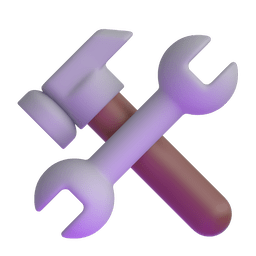

<p align="center">
  <a href="https://fazilvk.netlify.app"></a>
  <a href="https://linkedin.com/in/muhammed-fazil-vk"></a>
  <a href="https://t.me/fazilvk"></a>
  <a href="mailto:fazilvk6@gmail.com"></a>
</p>

<br/>

##  Quick Facts


```yaml
Name: Fazil VK
From: India 🇮🇳
Role: AI Engineer + Full Stack Developer

Currently:
  → Maintaining FluxTube (YouTube App Client)
  → AI & Machine Learning Dev
  → Open to collaborations

Stack: RAG | Flutter | Node.js | Python | Firebase

Quote: "I miss my mind more than my bugs!"
```

<br clear="right"/>

<br/>

<br/>

##  Tech Arsenal

<p align="center">
  
  <br/>
  
</p>
<p align="center">
  
  
  
  
</p>

<br/>

##  FluxTube

<p align="center">
  <a href="https://github.com/mu-fazil-vk/FluxTube"></a>
  <a href="https://github.com/mu-fazil-vk/FluxTube"></a>
  <a href="https://github.com/mu-fazil-vk/FluxTube"></a>
</p>

<p align="center">
  <a href="https://github.com/mu-fazil-vk/FluxTube/releases/latest"></a>
  <a href="https://github.com/mu-fazil-vk/FluxTube/stargazers"></a>
  <a href="https://github.com/mu-fazil-vk/FluxTube/releases"></a>
</p>

<br/>

##  GitHub Stats

<p align="center">
  
  
</p>
<p align="center">
  
</p>

<br/>

<p align="center">
  <a href="https://www.buymeacoffee.com/fazilvk"></a>
</p>


