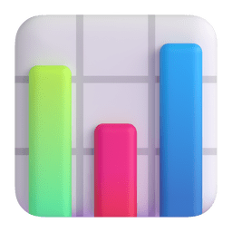

<div align="center">

<!-- Animated Header -->


<!-- Typing Effect -->
<a href="https://github.com/mu-fazil-vk">
  
</a>

<br/>

<!-- Quick Stats Badges -->
<a href="https://github.com/mu-fazil-vk">
  
</a>
<a href="https://fazilvk.netlify.app">
  
</a>


<br/><br/>

<!-- Profile Stats Row -->

&nbsp;
<a href="https://github.com/mu-fazil-vk?tab=followers">
  
</a>
&nbsp;


</div>

<br/>


<br/>

##  Quick Facts


```yaml
Name: Fazil VK
From: India 🇮🇳
Role: AI Engineer + Full Stack Developer

Currently:
  → Maintaining FluxTube (YouTube App Client)
  → AI & Machine Learning Dev
  → Open to collaborations

Stack: RAG | Flutter | Node.js | Python | Firebase

Quote: "I miss my mind more than my bugs!"
```

<br clear="right"/>

<br/>


<br/>

##  Tech Arsenal

<div align="center">


<br/>


<br/>


<br/><br/>

**`🤖 AI/ML Stack`**

<br/>


<br/>


</div>


<br/>

##  GitHub Stats

<div align="center">

<a href="https://github.com/mu-fazil-vk">
  
  
</a>

<br/><br/>

<a href="https://github.com/mu-fazil-vk">
  
</a>

<br/><br/>

<a href="https://github.com/mu-fazil-vk">
  
</a>

</div>

<br/>


<br/>

##  Featured Project

<div align="center">

### [FluxTube](https://github.com/mu-fazil-vk/FluxTube)

A privacy-friendly YouTube client for Android: no ads, no account, no Google services.

<a href="https://github.com/mu-fazil-vk/FluxTube">
  
  
  
</a>

[](https://github.com/mu-fazil-vk/FluxTube/releases/latest)
[](https://github.com/mu-fazil-vk/FluxTube/releases)

[](https://github.com/mu-fazil-vk/FluxTube/releases)
[](https://github.com/mu-fazil-vk/FluxTube)

</div>

<br/>


<br/>

##  Achievements

<div align="center">


</div>

<br/>


<br/>

##  Connect With Me

<div align="center">

<a href="https://linkedin.com/in/muhammed-fazil-vk" target="_blank">
  
</a>
<a href="https://instagram.com/fazil.v.k" target="_blank">
  
</a>
<a href="https://t.me/fazilvk" target="_blank">
  
</a>
<a href="mailto:fazilvk6@gmail.com" target="_blank">
  
</a>
<a href="https://fazilvk.netlify.app" target="_blank">
  
</a>

<br/><br/>

<!-- Support -->
<a href="https://www.buymeacoffee.com/fazilvk">
  
</a>

<br/><br/>

<!-- Random Quote -->


</div>

<br/>

<!-- Footer -->

